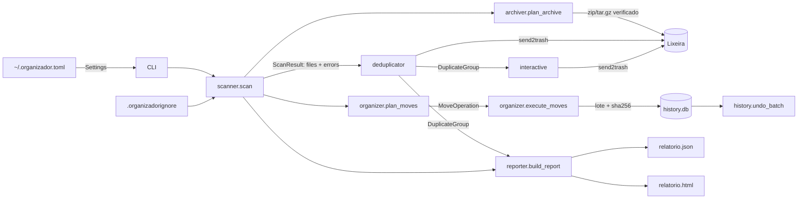
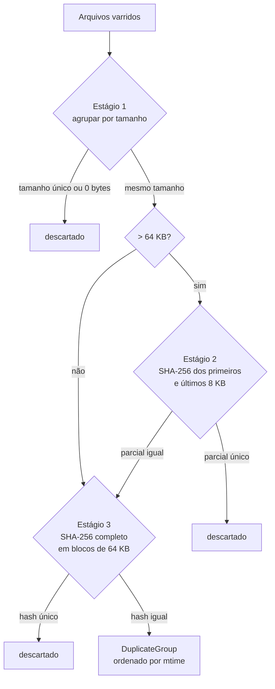
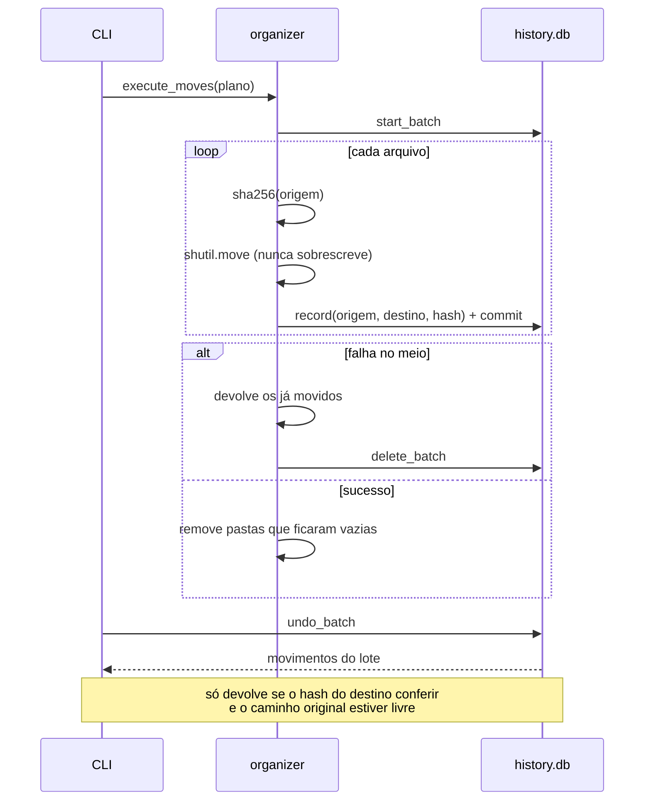

# Arquitetura

```
src/organizador/
  cli.py           comandos Typer, saída Rich (sem lógica de negócio)
  config.py        Settings (Pydantic) <- ~/.organizador.toml, com padrões embutidos
  models.py        FileMetadata, ScanResult, DuplicateGroup, MoveOperation, ExecutionBatch, ScanReport
  scanner.py       os.walk sem seguir links, .organizadorignore, filtros; erros coletados
  deduplicator.py  3 estágios + lixeira (send2trash)
  organizer.py     plano de movimentos + execução transacional
  archiver.py      pacotes zip/tar.gz por ano com verificação de integridade
  history.py       SQLite (lotes, movimentos, hash) + undo verificado
  reporter.py      ScanReport -> JSON / HTML com SVG
  interactive.py   revisão de duplicados com prompts Rich
```

## Fluxo de dados



## Algoritmo de deduplicação



Os estágios 2 e 3 rodam num `ThreadPoolExecutor`, porque o tempo vai em leitura de disco. Um arquivo ilegível
(sem permissão, removido durante a varredura) é descartado do grupo sem interromper o resto.
Arquivos vazios não entram, porque são todos "iguais" e apagá-los não libera espaço.

## Organização transacional e rollback



## Decisões

**Segurança**
- **Nada é apagado de vez.** Duplicados e originais compactados vão para a lixeira (`send2trash`).
- **Links simbólicos não são seguidos**: arquivos-link são ignorados e `os.walk(followlinks=False)` evita loops.
- **Junções do Windows não são detectadas no Python 3.11.** Uma junção circular pode ser percorrida.
- **Histórico e config nunca são movidos**, mesmo ao organizar a pasta pessoal.
- **Caminhos `folder` das regras regex são validados** (relativos, sem `..`) para nada sair da pasta alvo.

**Escopo**
- **`.organizadorignore` é um subconjunto do `.gitignore`**, sem negação `!` e sem `**`.
